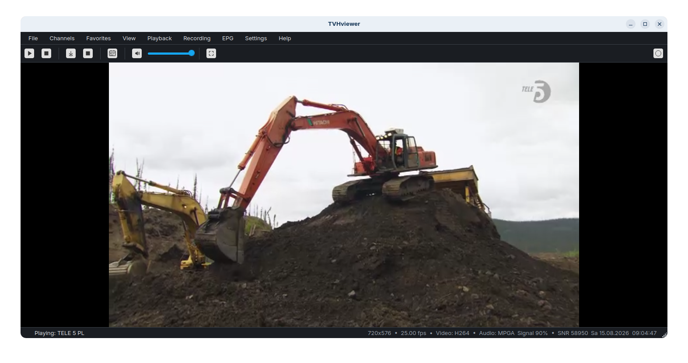

# TVHviewer

More modern desktop client for [TVHeadend](https://tvheadend.org/). Watch and record live TV on PC.

**TVHviewer is a fork of [TVHplayer](https://github.com/mfat/tvhplayer) by mFat.**
See [NOTICE.md](NOTICE.md) for full credits and a summary of what changed in this fork.



## Features

- Live TV & radio playback
- Full program guide: all channels at once, with a scrollable timeline
  view and a newspaper-style column view
- Dark / Light color theme
- Favorites menu, separate from the full channel browser
- Local recording (saves to disk via VLC/ffmpeg) with remembered save location
- Launch Kodi from the app (File menu / toolbar, path under Settings →
  Kodi Path): live TV pauses while Kodi runs and resumes when it closes
- Optional on-screen display (OSD) drawn from skins you provide yourself, with
  Media Center style keys (see below)
- Server status, tuner signal strength, and video/audio format shown
  in the status bar
- Cross-platform (Linux x86_64 and arm64, Windows) — this fork has mainly been
  tested on Linux (Zorin OS / Ubuntu)

## Install

### Debian/Ubuntu (.deb)
Download the latest `.deb` from [Releases](../../releases) and install:
```bash
sudo apt install ./tvhviewer_*.deb
```
The `.deb` is architecture independent and works on x86_64 and arm64 (e.g. Raspberry Pi).

### Linux (AppImage / single binary)
Releases also contain a portable `.AppImage` and a single-file binary for x86_64 and for
arm64 (`aarch64`). VLC must be installed on the system; ffmpeg is needed for local recording.

### Windows (installer)
Download the latest `tvhviewer-X.X.X-setup.exe` from [Releases](../../releases)
and run it. ffmpeg (for local recording) is bundled — you only need
**[VLC](https://www.videolan.org/vlc/) installed separately**, since
python-vlc only provides bindings to your system's VLC installation,
not VLC itself.

### From source
```bash
git clone https://github.com/honeyx/tvhviewer.git
cd tvhviewer
python3 -m venv venv
source venv/bin/activate
pip install -r runtime-requirements.txt
pip install PyQt5
sudo apt install vlc   # native VLC library, not from pip
cd tvhplayer
python3 tvhplayer.py
```

## License

GNU General Public License v3.0 — see [LICENSE](LICENSE).
This is the same license as the original TVHplayer project.

## OSD skins (optional)

TVHviewer can draw an on-screen display (volume bar, clock, channel/now-next
info) from skins in the XML "OSDSkin 1.1" layout. **No skins are included.**
Copy a skin folder you are entitled to use into the `OSDskins` folder
(Settings → OSD Skin → *Open OSDskins Folder*; located in the TVHviewer config
directory, e.g. `%APPDATA%\TVHplayer\OSDskins` on Windows) and pick it under
Settings → OSD Skin. The default is *Off*.

TVHviewer reads OSD skins in the format used by DVBViewer™ (OSDSkin 1.1), so skins made
for DVBViewer can be used with it. TVHviewer is an independent project and is not affiliated
with, authorised or endorsed by the makers of DVBViewer. DVBViewer™ is a product and trademark of
CM&V Hackbart (Christian Hackbart); all other product names and trademarks mentioned belong to
their respective owners.

### Using a skin

1. Copy the skin's folder (for example `Xbox` or `concinnity 3D`) into the `OSDskins`
   folder of the TVHviewer config directory (Settings → OSD Skin → *Open OSDskins Folder*).
2. Put a `windowdef.xml` into the same `OSDskins` folder (it defines the menu entries, see below).
3. Choose the skin under Settings → OSD Skin. *Off* switches the OSD off again.

Skins have their own licence (some are free, some are not): TVHviewer does not ship any, so
check the licence of a skin before you use or pass it on.

### Keys, remote control and `.remote` profiles

Settings → *Keyboard / Remote Keys...* shows every command with two key fields. Click a field
and press the key or key combination (a remote or Flirc just sends key presses); the old key is
overwritten, and a key that another command already uses is taken over from it. The keys are kept
in a `.remote` profile (the same XML format DVBViewer uses): *Save* writes the profile in use,
*Save as...* writes a new one under another name, *Open .remote file...* loads another one.
The profile in use is remembered; the default is `default.remote` in the config directory,
which is created from a Windows Media Center (Flirc) layout on first start. Commands of
the file that TVHviewer does not know (teletext, ...) stay in the file untouched.

Default keys: `Ctrl+D` OSD menu, `Ctrl+G` channel EPG, `E` EPG window, `K` channel list,
`Ctrl+O` favourites, `Enter`/`Backspace` OK/back, arrow keys navigate, `Ctrl+E` / `Ctrl+I` /
`Ctrl+T` / `Ctrl+M` the red / green / yellow / blue buttons, `M` mute, `+`/`-` channel up/down,
`PgDown`/`PgUp` next/previous favourite, `Shift+1`...`Shift+0` favourite 1-10, `0`-`9` direct
channel entry, `Space` pause, `X` stop, `R` local recording, `Shift+Left`/`Shift+Right` jump
30 s, `P` aspect ratio, `F` or `Alt+Enter` fullscreen. The volume keys of the keyboard and
`Esc` (back), `Ctrl+P` (pause) work in addition to the profile. Commands for opening single OSD windows
(*OSD Timeline*, *OSD Timer*, *OSD Recordings*, *OSD Videos*, *OSD Music*, *OSD Pictures*,
*OSD HTPC Menu*) have no key by default.

Coloured buttons: the captions come from the skin, the function depends on the window.
Blue opens the OSD menu (in the channel list and the file windows it is *Kontext*, a small
menu). Timeline: red is *Channel EPG* while the channel name is selected and becomes *Record*
after `Right` moved onto a programme (`Left` goes back); green jumps to now, yellow two hours
forward. Channel EPG: red records the programme, green jumps to the first programme, yellow
tunes the channel. Channel list: red switches TV / favourites, green opens the channel EPG,
yellow the favourites editor. Recordings: red changes the sort order, green shows the entry,
yellow deletes it (asks first); Timer: yellow cancels the timer. File windows: yellow goes one
folder up; *Add* and *Playlist* are not available yet.

With an OSD skin selected, `K` (channel list) and `Ctrl+O` (favourites) open a
skinned list you navigate with the remote: `Up`/`Down`/`Left`/`Right`, `Enter`
(tune) and `Backspace`/`Esc` (close). Pressing the same key again closes the
window, it also closes itself after 40 seconds without input, and channel
+/- and favourite +/- keep working while it is open. Settings → OSD Skin →
*Transparency...* sets how see-through the OSD is. The OSD only shows while
TVHviewer is the active program. Without a skin `K` opens a plain channel
chooser. `Ctrl+K` opens the skinned channel list directly, `I` shows the info
bar, and `Ctrl+D` opens the OSD menu: a ring of entries (channel list, clock,
Kodi, ...) built from the `windowdef.xml` in the OSDskins folder. Copy the
`windowdef.xml` of your DVBViewer installation there: it defines the entries,
their icons (`Image`) and the sub menus (`Parent`, e.g. Media Center, System).
If there is none, a small one is created. How the menu looks - ring of icons or
a vertical text list, main menu and sub menu - is taken from the selected skin,
so every skin is shown the way it is designed; an icon a skin doesn't have is
left empty (listed in `tvhviewer.log`). To add Kodi, add a `<Window Name="Kodi"
Text="Kodi" ID="-3" Parent="0">` entry with `<Image>home_kodi.png</Image>` and
`<Application>` (path to Kodi). `Left`/`Right` (ring) or `Up`/`Down` (list)
choose, `Enter` runs or opens a sub menu, `Backspace` goes back / closes.
Entries for windows that are not built yet say so.

Settings → *Video / Recordings / Pictures / Music Folder...* set where those
files are; a network path works as well (`\\\\server\\share` on Windows, a
mounted share such as `/mnt/nas/...` on Linux). The matching menu entries (and the File menu)
open a skinned file list: `Up`/`Down`/`PgUp`/`PgDn` move, `Enter` plays a file,
shows a picture (`Left`/`Right` for the next one) or opens a folder, `Backspace`
goes one folder up (or closes at the top). `Ctrl+G` (menu entry *Program*)
opens the skinned channel EPG: `Up`/`Down` choose a programme, `Left`/`Right`
switch the channel, `Enter` tunes it.
The menu entry *Timeline* shows the skinned
timeline: the current channel sits in the middle row, a vertical line marks the
current time. `Up`/`Down` change the channel, `Left`/`Right` move through the
programmes, `Enter` tunes the channel. The row count follows the skin's layout.
*Timer* lists the upcoming recordings stored on the Tvheadend server. *Recordings*
(File menu: *Play Server Recording...*) lists the finished recordings on the server and plays
them over HTTP from Tvheadend, so no shared folder is needed; the local folder settings stay
available for recordings made by the viewer itself. *EPG now* opens the same window as the
channel EPG. The home menu reopens at the entry you used last. Skins whose windows have a small video
window show the live picture there as a thumbnail (a snapshot once a second). More OSD windows
(CAM, ...) are work in progress.

Unhandled errors and crashes are written to `tvhviewer.log` in the config
directory - please attach it when reporting a problem.
